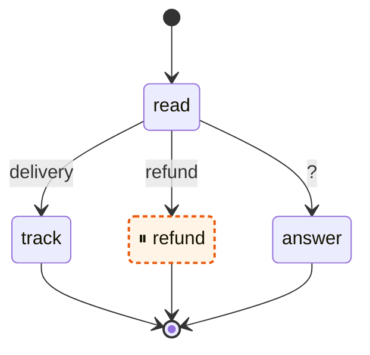

# Inspecting a graph

`CompiledGraph.topology` describes the compiled graph, which is enough to draw it or to check its
shape in a test. For the graph of [Parallel branches](parallel-branches.md):

```kotlin
val topology = graph.topology
topology.nodes                 // [web, docs, summarize]
topology.successors(START)     // [web, docs]: what can run after START
topology.edges                 // GraphEdge(from, to, isConditional) for every known arrow
topology.dynamicRoutes         // nodes whose conditional edge declares no targets
topology.subgraphs             // the topology of the graph behind each subgraph node, by its name
```

## Draw it

`toMermaid()` writes the graph as a [Mermaid](https://mermaid.js.org) state diagram. GitHub, GitLab
and this site show a code block of the language `mermaid` as a picture, so the output can go
straight into a README or a pull request:

```kotlin
println(
    graph.toMermaid(
        config = config, // marks the nodes of interruptBefore and interruptAfter with ⏸
        edgeLabels = mapOf(("read" to "track") to "delivery", ("read" to "refund") to "refund"),
    ),
)
```

For the help desk of [level 2 of the tutorial](../tutorial/02-choices.md), with a pause before
`refund`:

```
stateDiagram-v2
    state "read" as n0
    state "track" as n1
    state "⏸ refund" as n2
    state "answer" as n3
    [*] --> n0
    n0 --> n1 : delivery
    n0 --> n2 : refund
    n0 --> n3 : ?
    n1 --> [*]
    n2 --> [*]
    n3 --> [*]
    classDef interrupt fill:#fff4e5,stroke:#e8590c,stroke-width:2px,stroke-dasharray:4 3
    class n2 interrupt
```



- `START` and `END` are the `[*]` of the diagram.
- A conditional edge gets its label from `edgeLabels`, or `?` when it has none. A node whose
  conditional edge declares no `targets` gets a note that it can route to any node.
- A subgraph is a state that holds the diagram of its graph.
- Nodes the run pauses before start with ⏸, nodes it pauses after end with it, and both are
  highlighted. `GraphTopology.toMermaid` takes the two sets directly, for a topology without a
  config.

A name or an edge in `config` or `edgeLabels` that is not in the graph throws a
`GraphValidationException`.
